<script>
if (window.location.hostname === 'denny.one') {
  window.dataLayer = window.dataLayer || [];
  window.gtag = function () { window.dataLayer.push(arguments); };
  window.gtag('js', new Date());
  window.gtag('config', 'G-SJL6EQRW3V');
  const script = document.createElement('script');
  script.async = true;
  script.fetchPriority = 'low';
  script.src = 'https://www.googletagmanager.com/gtag/js?id=G-SJL6EQRW3V';
  document.head.appendChild(script);
}
</script>

<!-- _paginate: false -->
<!-- _footer: "" -->
<!-- _class: archetype-cover -->

<div class="cover-visual">
  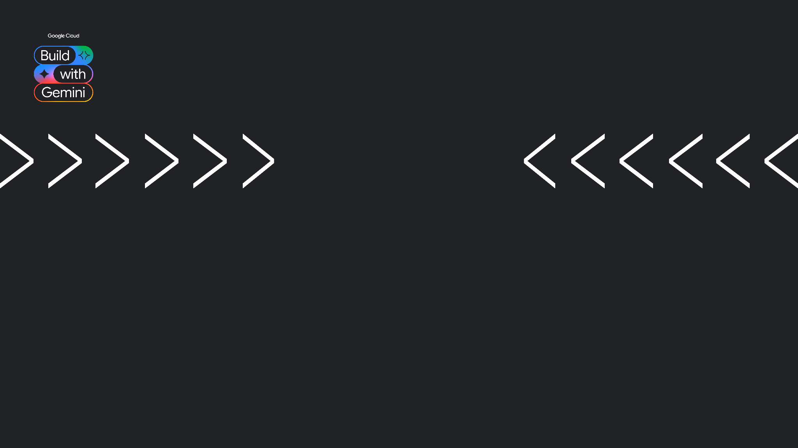
  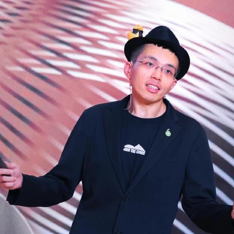
</div>

# 你的開發環境跟上 AI 時代了嗎？

## 用 Antigravity 讓開發工具自己進化

<p class="cover-byline">Denny Huang</p>
<p class="cover-date"><time datetime="2026-11-20">2026.11.20</time></p>

---

<!-- _paginate: false -->
<!-- _class: archetype-link arrow-layout -->

# 投影片

<a class="slide-link" href="https://denny.one/20261120-google-cloud/">
  <span class="qr-field"></span>
  <span>denny.one/20261120-google-cloud/</span>
</a>

---

<!-- _class: archetype-title -->

# 我是<br>*CLI* 狂熱者

---

<!-- _class: archetype-speaker -->

# Denny Huang

- GDG Cloud Taipei Organizer
- <a href="https://sitcon.org/" target="_blank">SITCON 學生計算機年會</a> 共同發起人
- <a href="https://coscup.org/" target="_blank">COSCUP 開源人年會</a> 長期志工
- <a href="https://hitcon.org/" target="_blank">HITCON 台灣駭客年會</a>  長期志工
- 曾任雷亞遊戲（Rayark Inc.） 資料分析團隊主管
- <a href="https://denny.one/" target="_blank">About me</a>

---

<!-- _class: archetype-quote -->

# 最近，*寫程式以外的工作*<br>也變多了

> Markdown、diff、計畫、<br>文件、圖表、Agent 回覆……

---

<!-- _class: archetype-table -->

# 哪些操作<br>可以更順手？

| 操作 | 工具 |
|---|---|
| 找出 diff 裡改動的數字 | 用 **delta** 看 `git diff` |
| 選取終端機上的檔案路徑 | **Kitty Hints** |
| 預覽圖片和流程圖 | **Neovim + md-render.nvim** |

---

<!-- _class: archetype-two-panel -->

# 同一份 diff，閱讀體驗差多少？

<p><code>config.toml</code> 裡的 <code>timeout_seconds</code> 從多少改成多少？　<a href="https://github.com/dandavison/delta">delta</a></p>

<div class="layout-two">
  <div>
    <span class="panel-label">Git</span>
    <h2>整行增刪</h2>
    <div class="media-slot">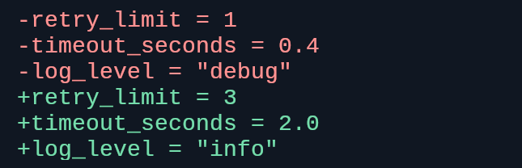</div>
  </div>
  <div>
    <span class="panel-label">delta</span>
    <h2>行內標色</h2>
    <div class="media-slot">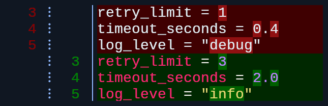</div>
  </div>
</div>

---

<!-- _class: archetype-media -->

# Kitty Hints<br>快速抄寫路徑

<div class="layout-media">
  <div>
    <h2><a href="https://github.com/denny0223/kitty-showcase/">kitty-showcase</a> · 03 選取</h2>
  </div>
  <div class="media-slot">
    <video id="kitty-hints" src="assets/demo/kitty-hints.mp4" poster="assets/demo/kitty-hints.png" width="760" height="360" controls muted playsinline preload="none" loading="lazy" aria-label="播放 Kitty Hints 實機操作。選取路徑後，cat 顯示 timeout_seconds = 2.0。">瀏覽器可直接開啟<a href="assets/demo/kitty-hints.mp4">操作影片</a>。</video>
  </div>
</div>

<script>
document.addEventListener('DOMContentLoaded', () => {
  const view = document.body.dataset.bespokeView;
  if (view !== '' && view !== 'presenter') return;

  const video = document.getElementById('kitty-hints');
  const slide = video.closest('.bespoke-marp-slide');
  let wasActive = false;
  function syncPlayback() {
    const active = slide.classList.contains('bespoke-marp-active');
    if (active === wasActive) return;
    wasActive = active;

    if (active) {
      video.currentTime = 0;
      video.play().catch(() => {
        // Native controls allow manual playback if the browser blocks autoplay.
      });
    } else {
      video.pause();
    }
  }
  new MutationObserver(syncPlayback).observe(slide, { attributeFilter: ['class'] });
  syncPlayback();
});
</script>

---

<!-- _class: archetype-media -->

# 在 Neovim 裡<br>預覽 Markdown 圖片

<div class="layout-media">
  <div>
    <p><code></code></p>
  </div>
  <div class="media-slot">
    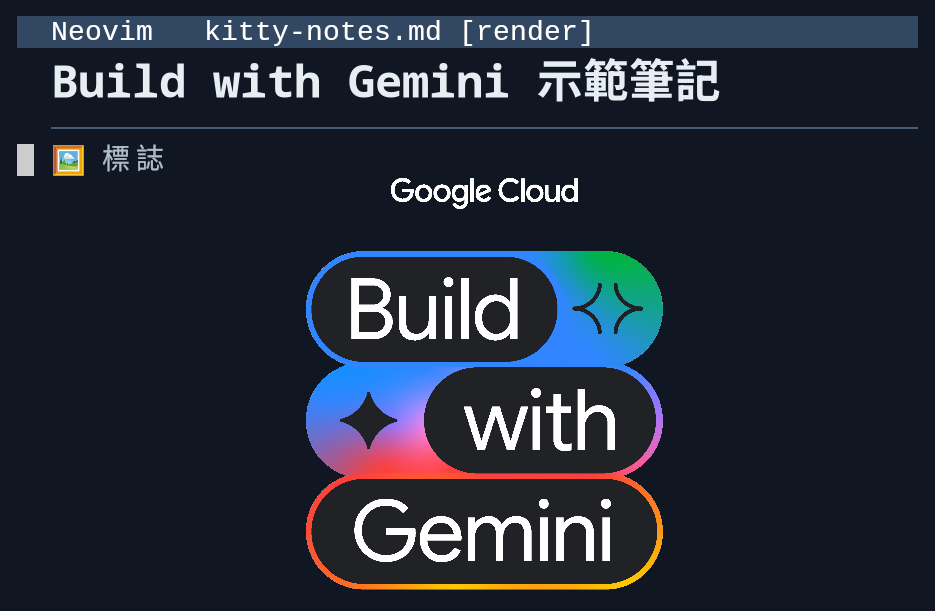
  </div>
</div>

[示範筆記](assets/demo/kitty-notes.md) · [md-render.nvim](https://github.com/denny0223/md-render.nvim)<br>fork 自 [delphinus/md-render.nvim](https://github.com/delphinus/md-render.nvim)

---

<!-- _class: archetype-media -->

# 同一份筆記裡的<br>Mermaid 流程圖

<div class="layout-media">
  <div>
    <p><code>flowchart LR</code></p>
  </div>
  <div class="media-slot">
    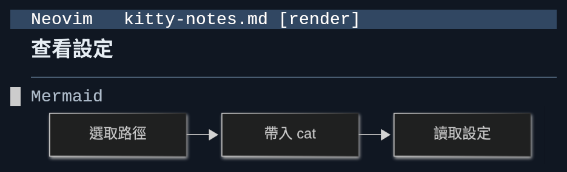
  </div>
</div>

[Mermaid 原文](assets/demo/kitty-notes.md)

---

<!-- _class: archetype-quote quote-blue -->

# 讀 diff、看圖，<br>都在熟悉的*終端機*裡

---

<!-- _paginate: false -->
<!-- _footer: "" -->
<!-- _class: archetype-logo -->

# 

---

<!-- _class: archetype-process arrow-layout -->

# 把工作交給 Agent

<ol class="agenda-list">
  <li><strong>需求</strong><span>要完成什麼？</span></li>
  <li><strong>計畫</strong><span>用 <code>/plan</code> 確認做法</span></li>
  <li><strong>實作</strong><span>用 <code>/diff</code> 看改動</span></li>
  <li><strong>檢查</strong><span>跑測試，核對需求</span></li>
</ol>

---

<!-- _class: archetype-two-panel -->

# 動手前先用 `/plan`

<div class="layout-two">
  <div>
    <span class="panel-label">交辦時</span>
    <h2>目標是什麼？</h2>
    <p>哪些習慣要保留？</p>
  </div>
  <div>
    <span class="panel-label">看計畫時</span>
    <h2>有沒有漏掉限制？</h2>
    <p>怎麼驗收？</p>
  </div>
</div>

[Antigravity Plan](https://antigravity.google/docs/plan/)

---

<!-- _class: archetype-quote spoken-quote -->

> *拉高層次和視野格局*，  
> 也告訴我多方觀點<br>subagent 的建議

---

<!-- _class: archetype-table -->

# 任務怎麼分工？

| 方式 | 什麼時候用 |
|---|---|
| 一般 Agent | 需要邊做邊調整 |
| `/boost` | 同一道難題，想試幾種解法 |
| `/swarm` | 能分頭做，過程中需要互通進度 |
| `/teamwork` | 要分階段交付、逐段驗收 |

[官方多代理選擇說明](https://antigravity.google/docs/boost/#when-to-use-boost)

---

<!-- _class: archetype-three-panel -->

# 用 `/swarm` 時，誰做什麼？

<div class="layout-three">
  <div><span class="panel-label">Coordinator</span><h2>拆工作</h2><p>決定誰改哪些檔案。</p></div>
  <div><span class="panel-label">Worker</span><h2>分頭做</h2><p>在看板回報進度，<br>標出卡住的地方。</p></div>
  <div><span class="panel-label">Verifier</span><h2>檢查改動</h2><p>看 diff、跑測試，<br>請原作者修正問題。</p></div>
</div>

[Antigravity 的 Swarm 分工](https://antigravity.google/docs/swarm/#how-it-works)

---

<!-- _class: archetype-quote quote-blue -->

# Agent 可以同時工作

> 如果都在改*同一份工作目錄*呢？

---

<!-- _class: archetype-table directory-table -->

# 同一個 repo，<br>三個工作目錄

| 工作目錄 | 分支 | 用途 |
|---|---|---|
| `md-render.nvim/` | `main` | 日常開發 |
| `md-render-docs/` | `docs-update` | 文件修改 |
| `md-render-test/` | `test-preview` | 預覽實驗 |

每個 **Git worktree**<br>都有獨立的檔案和 index。

[Git 官方文件](https://git-scm.com/docs/git-worktree)

---

<!-- _class: archetype-two-panel command-panel -->

# `git worktree`：不用再 clone 三份

<div class="layout-two">
  <div>
    <span class="panel-label">指令</span>
    <h2>從目前的 repo 新增工作目錄</h2>

```sh
git worktree add -b docs-update \
  ../md-render-docs

git worktree list
```

  </div>
  <div>
    <span class="panel-label">實際輸出</span>
    <h2>工作目錄</h2>
    <pre class="worktree-list"><samp>/work/md-render.nvim 3eb014c [main]
/work/md-render-docs 3eb014c [docs-update]
/work/md-render-test 3eb014c [test-preview]</samp></pre>
    <p>第一列是主工作目錄，<br>後兩列是新增的 worktree。</p>
  </div>
</div>

---

<!-- _class: archetype-two-panel -->

# Antigravity App 開新對話，在哪裡改檔？

<div class="layout-two">
  <div>
    <span class="panel-label">快速互動</span>
    <h2>Local Mode</h2>
    <p>在目前的工作目錄改檔。</p>
  </div>
  <div>
    <span class="panel-label">並行修改</span>
    <h2>New Worktree Mode</h2>
    <p>為這段對話另開 Git worktree。</p>
  </div>
</div>

[工作目錄選項](https://antigravity.google/docs/projects#worktree-selection-local-vs-new-worktree)

---

<!-- _class: archetype-media -->

# 用 tmux<br>和多個 Agent 互動

<div class="layout-media">
  <div>
    <p>用 <code>pane</code> 上下分割，<br>同時看 Claude Code 和 Codex。</p>
    <p>用 <code>window</code> 分開不同工作，<br>從「開發」切到「審查」。</p>
  </div>
  <div class="media-slot">
    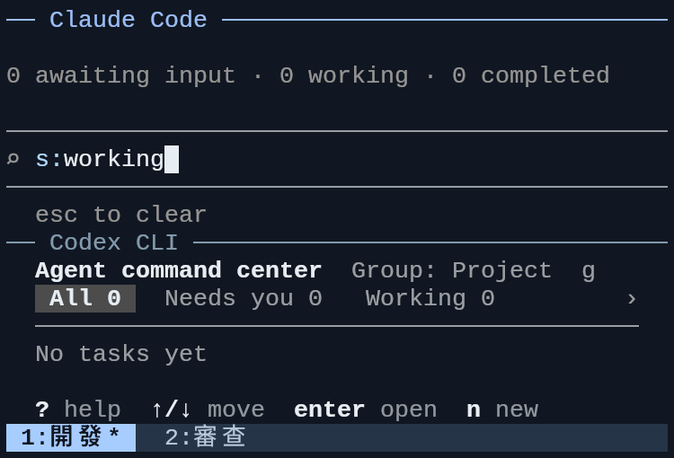
  </div>
</div>

---

<!-- _class: archetype-media swarm-board -->

# `/swarm board`<br>現在輪到誰？

<div class="layout-media">
  <div>
    <p><strong>Roster</strong> · 5 位成員<br>4 位等待，<code>verifier</code> 工作中。</p>
    <p><strong>Posts</strong> · 6 則貼文<br>最後兩則送給 <code>verifier</code> 審查。</p>
    <p><strong>Message</strong> · 第 6 則<br><code>importer</code> 送審，附上分支、commit 和檔案清單。</p>
  </div>
  <div class="media-slot">
    <a href="assets/demo/antigravity-board.png" target="_blank" rel="noopener">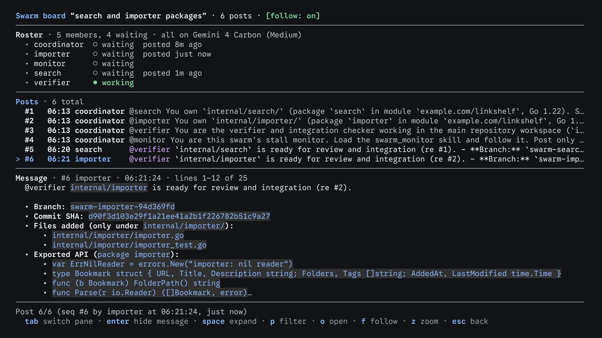</a>
  </div>
</div>

<p>
  <span>切換對話　<a href="https://code.claude.com/docs/en/agent-view"><code>claude agents</code></a> · <a href="https://learn.chatgpt.com/docs/developer-commands?surface=cli#codex-agents"><code>codex agents</code></a></span>
  <span>Antigravity 背景 Agent　<a href="https://antigravity.google/docs/cli/commands/agents/"><code>/agents</code></a>　｜　跨工具看狀態　<a href="https://herdr.dev/tui/docs/agents/">Herdr</a></span>
</p>

---

<!-- _class: archetype-rows -->

# 三個工具，<br>各管什麼？

<dl class="term-rows">
  <dt>Git worktree</dt><dd>修改放在哪裡？<br><strong>工作目錄／分支</strong></dd>
  <dt>tmux</dt><dd>哪些終端要放在一起看？<br><strong>window／pane</strong></dd>
  <dt>Antigravity</dt><dd>誰負責哪個子任務？<br><strong>Agent／審查</strong></dd>
</dl>

---

<!-- _class: archetype-two-panel -->

# `/learn` 提的建議，哪些要留？

<div class="layout-two">
  <div><span class="panel-label">規則範例</span><h2>Rule</h2><p>改檔前，先確認計畫。</p></div>
  <div><span class="panel-label">流程範例</span><h2>Skill</h2><p>交付前，看 diff、跑相關測試，<br>再逐項核對需求。</p></div>
</div>

[Antigravity Learn](https://antigravity.google/docs/commands/learn/)

---

<!-- _class: archetype-rows -->

# 回到你的<br>開發環境

<dl class="term-rows">
  <dt>需求</dt><dd>最近什麼工作變多了？</dd>
  <dt>阻力</dt><dd>哪個操作反覆卡住？</dd>
  <dt>嘗試</dt><dd>想先試哪個小改變？</dd>
</dl>

---

<!-- _paginate: false -->
<!-- _class: archetype-section unnumbered -->

# <span>工欲善其事，</span><span>必先利其器</span>

---

<!-- _paginate: false -->
<!-- _footer: "" -->
<!-- _class: archetype-closing -->

<div class="closing-mark">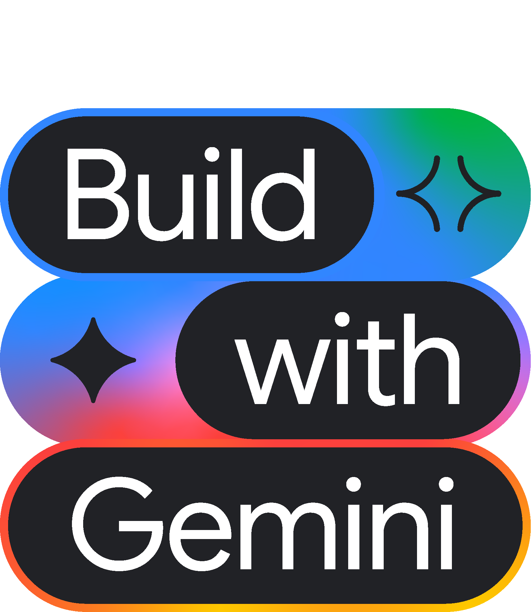</div>

# Thanks for listening

<div class="credits">
  <p>本投影片原創內容採用 <a href="https://creativecommons.org/licenses/by-sa/4.0/deed.zh-hant"> 創用 CC「姓名標示－相同方式分享 4.0 國際」</a>授權</p>
  <p><a href="https://marp.app/">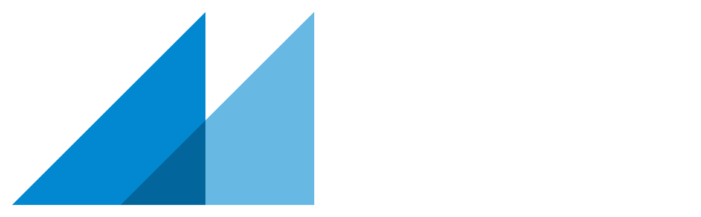 Marp</a> 製作</p>
</div>
